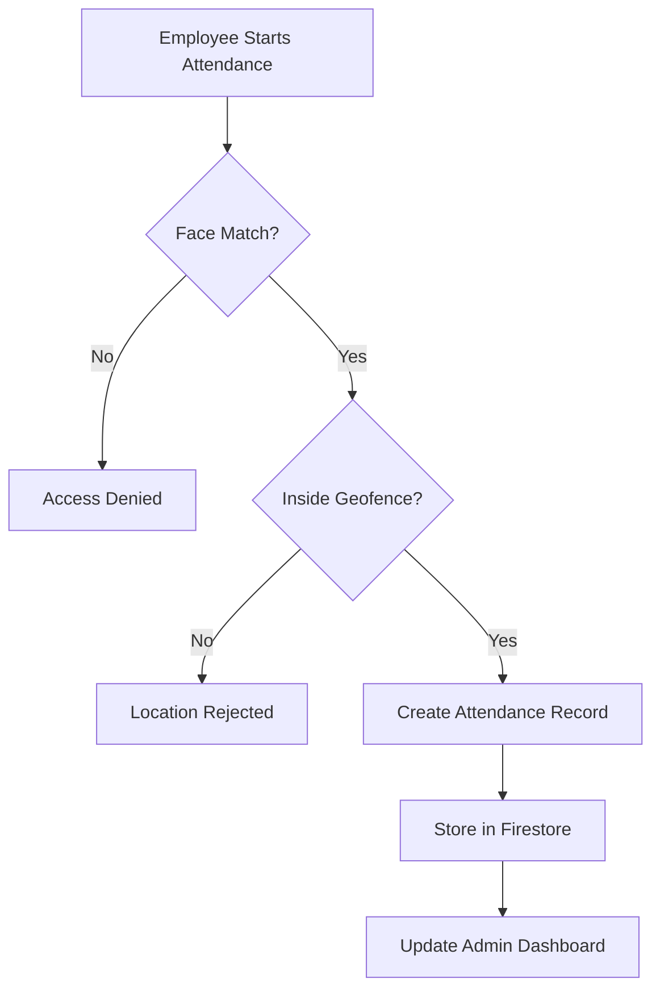

# Pratyaksha

A biometric and geolocation-based attendance system that combines face recognition, GPS geofencing, and timestamp validation to reduce proxy attendance and manage workforce attendance.

> **Status:** Active development / experimental release. Pratyaksha is not production-ready yet.

## What is Pratyaksha?

Pratyaksha is a web-based attendance and workforce management system designed to verify who is marking attendance, where they are marking it from, and when the attendance is recorded.

It does not require dedicated biometric attendance hardware.

Employees can use a supported device with a camera and location access to verify their identity and mark attendance.

```text
Employee Device
      ↓
Face Recognition
      ↓
GPS Geofence Validation
      ↓
Attendance Record
      ↓
Firebase Firestore
      ↓
Admin Dashboard
```

## Features

- Browser-based face recognition
- GPS geofencing for attendance validation
- Admin-defined office and work locations
- Configurable geofence radius
- Employee authentication using unique auth codes
- Date of birth verification
- Real-time attendance records
- Attendance analytics and visual reports
- Employee and workforce management
- Automatic absent marking
- Interactive map-based location setup
- Client-side biometric processing
- No dedicated biometric hardware required

## How Attendance Works

Pratyaksha uses three checks before attendance is recorded.

```text
Identity
   ↓
Face Recognition

Location
   ↓
GPS Geofence Validation

Time
   ↓
Attendance Timestamp
```

An employee must pass the required verification checks before the attendance record is created.

## Admin Dashboard

The admin dashboard is used to manage employees, work locations, and attendance data.

Admins can create virtual office locations by selecting a point on an interactive map and defining the allowed attendance radius.

```text
Admin Selects Location
        ↓
GPS Coordinates Saved
        ↓
Allowed Radius Defined
        ↓
Employee Location Checked
        ↓
Inside Geofence?
     ↙       ↘
   Yes        No
    ↓          ↓
Continue     Reject
```

The dashboard also provides attendance statistics and workforce information.

## Employee Portal

Employees can access the attendance system using their assigned credentials.

The employee verification flow includes:

```text
Auth Code
    ↓
Date of Birth
    ↓
Camera Access
    ↓
Face Verification
    ↓
Location Check
    ↓
Attendance Recorded
```

Attendance is only accepted when the required identity and location checks succeed.

## Face Recognition

Pratyaksha uses `face-api.js` for browser-based face recognition.

During registration, the employee's face is converted into a numerical face descriptor.

```text
Camera Image
     ↓
Face Detection
     ↓
Facial Features
     ↓
128-Value Descriptor
     ↓
Stored for Verification
```

During attendance, a new descriptor is generated and compared with the registered descriptor.

A match is accepted when the calculated face distance is within the configured threshold.

Pratyaksha currently uses a matching threshold of `0.35`.

## GPS Geofencing

Admins can define a work location using:

- Latitude
- Longitude
- Allowed radius

When an employee attempts to mark attendance, the browser retrieves the current device location.

```text
Employee Location
        +
Office Location
        ↓
Distance Calculation
        ↓
Within Allowed Radius?
     ↙             ↘
   Yes              No
    ↓                ↓
Continue          Reject
```

Attendance is only allowed when the employee is inside the configured geofence.

## Attendance Flow



## Authentication

Employees use a combination of:

```text
Unique Auth Code
        +
Date of Birth
        ↓
Employee Record Lookup
        ↓
Access Granted
```

This provides a simple login flow without requiring employees to manage traditional passwords.

## Attendance Analytics

The admin dashboard provides visual information about workforce attendance.

Current analytics include:

- Present and absent ratios
- Attendance trends
- Employee consistency
- Daily attendance information
- Workforce records

Charts are rendered using Chart.js.

## Automatic Absence Handling

Pratyaksha includes logic for marking employees absent when no attendance record is found for the required day.

```text
End of Attendance Period
          ↓
Check Attendance Record
          ↓
Record Exists?
      ↙        ↘
    Yes         No
     ↓           ↓
No Action    Mark Absent
```

The current implementation uses client-side scheduled logic.

## Tech Stack

| Component | Technology | Role |
| :--- | :--- | :--- |
| Frontend | HTML5 and JavaScript | Application interface and client logic |
| Styling | Tailwind CSS | Responsive user interface |
| Face Recognition | face-api.js | Face detection and verification |
| Machine Learning | TensorFlow.js | Browser-based model execution |
| Database | Firebase Firestore | Attendance and employee data |
| Maps | Leaflet.js | Interactive maps and geofencing |
| Charts | Chart.js | Attendance analytics |
| Alerts | SweetAlert2 | Application dialogs and notifications |

## Technical Architecture

Pratyaksha uses a browser-based and serverless architecture.

```text
Employee Browser
      ↓
Face Recognition
      ↓
Geolocation Validation
      ↓
Application Logic
      ↓
Firebase Firestore
      ↓
Admin Dashboard
```

Face recognition is processed on the client device.

Instead of using the original face image for every comparison, the system works with numerical face descriptors generated by the recognition model.

## Firestore Structure

Pratyaksha uses Firebase Firestore to manage application data.

The system stores information related to:

- Admin accounts
- Work locations
- Employees
- Face descriptors
- Attendance records
- Authentication codes

The application also uses Firestore `collectionGroup` queries to search employee records across separate server or workplace collections.

The exact database structure may evolve as the project develops.

## Current Limitations

Pratyaksha is currently an experimental project.

Currently:

- Face recognition depends on browser and camera support
- GPS accuracy depends on the user's device and environment
- Client-side location data can have platform limitations
- Automatic absence handling currently depends on client-side execution
- Internet access is required for Firebase operations
- Advanced liveness detection is still limited
- Large-scale production reliability has not yet been validated
- The system should not be used for critical workforce operations without additional security testing

## Good Use Cases

Pratyaksha is currently suitable for:

- Learning biometric authentication systems
- Exploring browser-based face recognition
- Attendance system prototypes
- College and academic projects
- Small workforce management experiments
- Geofencing demonstrations
- Exploring Firebase real-time applications

## Project Goal

The goal of Pratyaksha is to explore how identity, location, and attendance management can work together without dedicated biometric hardware.

```text
Face Recognition
       ↓
Identity Verification
       ↓
GPS Geofencing
       ↓
Location Verification
       ↓
Attendance Recording
       ↓
Workforce Analytics
```

Future versions may improve liveness detection, attendance automation, security, reporting, role management, and production reliability.

## Author

Built by Aaryan.

---

If you find a bug or want to contribute, contributions and feedback are welcome.

## Keywords

Pratyaksha
Attendance System
Biometric Attendance
Face Recognition
Face API.js
GPS Geofencing
Location Based Attendance
Employee Management
Workforce Management
Attendance Tracking
Firebase
Firestore
Computer Vision
Browser AI
JavaScript
Web Application
Authentication
HR Technology
Location Verification
Time Attendance
