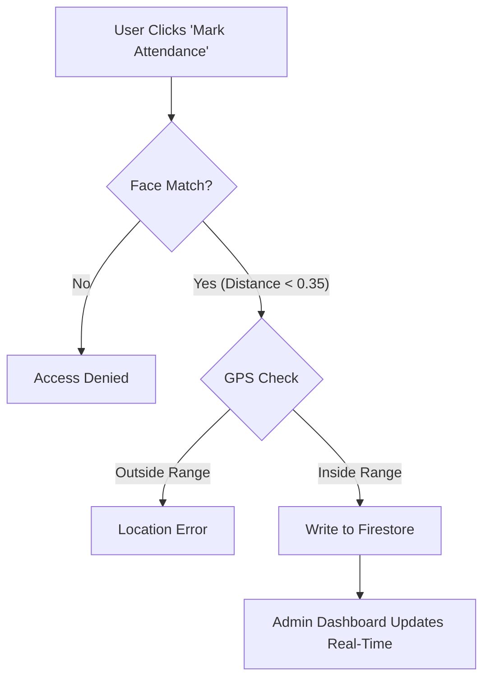

   
  
   
  <h1 align="center">Pratyaksha</h1>
  

    <strong>Next-Gen Biometric & Geolocation Workforce Management System</strong>
  

  

    A robust, fraud-proof attendance solution combining AI-powered Face Recognition with GPS Geofencing.
  

  

    
  

  
  

    
    
    
    
  

   

---

## 🚀 Overview

**Pratyaksha** (Sanskrit for "Direct Perception/Evidence") is an advanced SaaS-based attendance and workforce management platform designed to eliminate proxy attendance and streamline remote workforce tracking.

Unlike traditional biometric systems that require hardware, Pratyaksha turns any smartphone/laptop into a secure attendance terminal. It implements a **Three-Factor Authentication Protocol**:
1.  **Who you are:** Face Recognition (AI Biometrics).
2.  **Where you are:** GPS Geofencing (Spatial Validation).
3.  **When you are:** Server-side Timestamping (Temporal Validation).

---

## ✨ Key Features

### 🏢 The Admin Command Center
* **Dynamic Geofencing:** Admins can create virtual "Servers" (Offices/Sites) by setting a GPS center point and an allowable radius (e.g., 500 meters) using an interactive map interface.
* **Real-Time Analytics:** Visualize attendance trends, present/absent ratios, and employee consistency via interactive Chart.js graphs.
* **Workforce Management:** Add employees, generate unique **Auth Codes**, and manage personnel records in real-time.

### 👤 The Employee Portal
* **AI Face Authentication:** Uses `face-api.js` to generate 128-point face descriptors, ensuring high-accuracy identity verification (Threshold: 0.35) directly in the browser.
* **Passwordless Entry:** Secure login using a unique Auth Code + Date of Birth combination, reducing login friction while maintaining security.
* **Live Liveness & Location Check:** Attendance is only marked if the user matches the registered face **AND** is physically located within the Admin-defined geofence.

### 🛡️ Smart Security & Logic
* **Collection Group Indexing:** Utilizes advanced Firestore `collectionGroup` queries to perform global searches for employees across disjointed server collections.
* **Auto-Absent Protocol:** A client-side scheduled task that automatically marks employees as "Absent" if no attendance record is found by the end of the day.
* **Anti-Spoofing:** Blocks static image attacks by requiring live camera feed analysis.

---

## 🏗️ Technical Architecture

Pratyaksha operates on a **decentralized, serverless architecture**.

### 1. The Biometric Handshake
Instead of sending images to a server (privacy risk), Pratyaksha processes biometrics on the edge (Client-Side):
> The neural network converts the face into a `Float32Array` (Descriptor). Only this mathematical representation is encrypted and stored in Firestore, ensuring GDPR compliance and user privacy.

### 2. The Verification Logic Flow

---

## 💻 Tech Stack

| Component | Technology | Role |
| :--- | :--- | :--- |
| **Frontend Core** | HTML5, ES6 Modules | Lightweight, fast execution without bundlers. |
| **Styling** | Tailwind CSS | Rapid, responsive, and glassmorphism UI design. |
| **AI / ML** | face-api.js (TensorFlow.js) | Client-side face detection and recognition. |
| **Database** | Firebase Firestore | Real-time NoSQL database and offline persistence. |
| **Mapping** | Leaflet.js | Open-source interactive maps for geofencing. |
| **Alerts** | SweetAlert2 | Professional, responsive modal dialogs. |

---

 <h3>Designed & Developed by <a href="https://github.com/computerBoy-dev">Aaryan</a></h3> 
 Built with ❤️ and ☕ for developers. 
 

